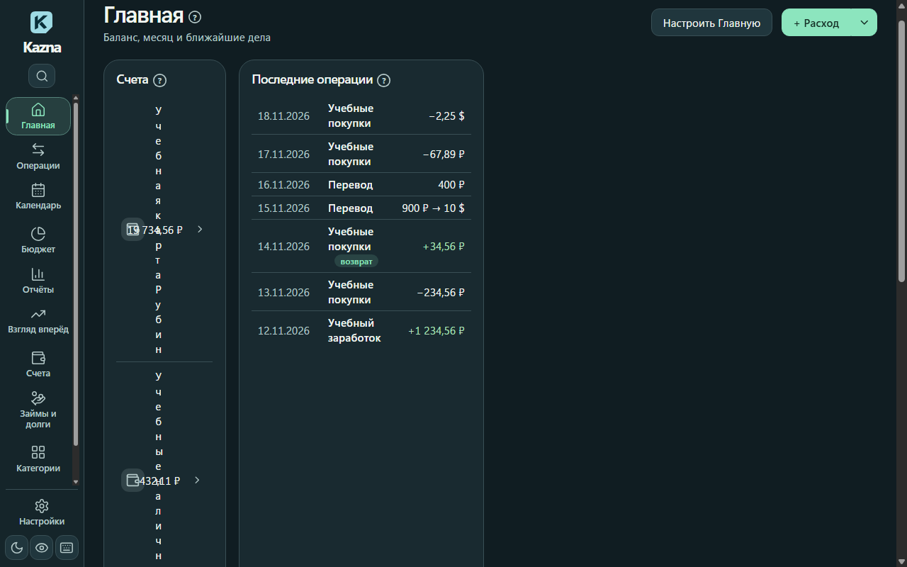
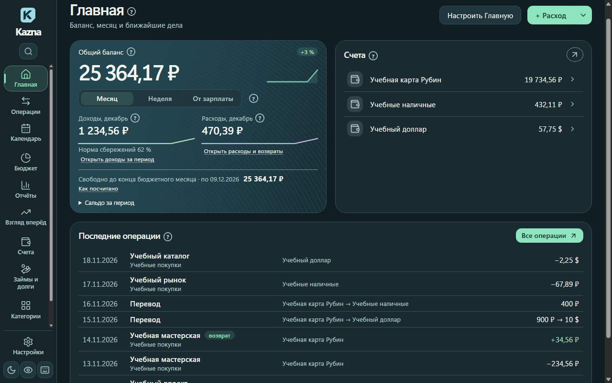
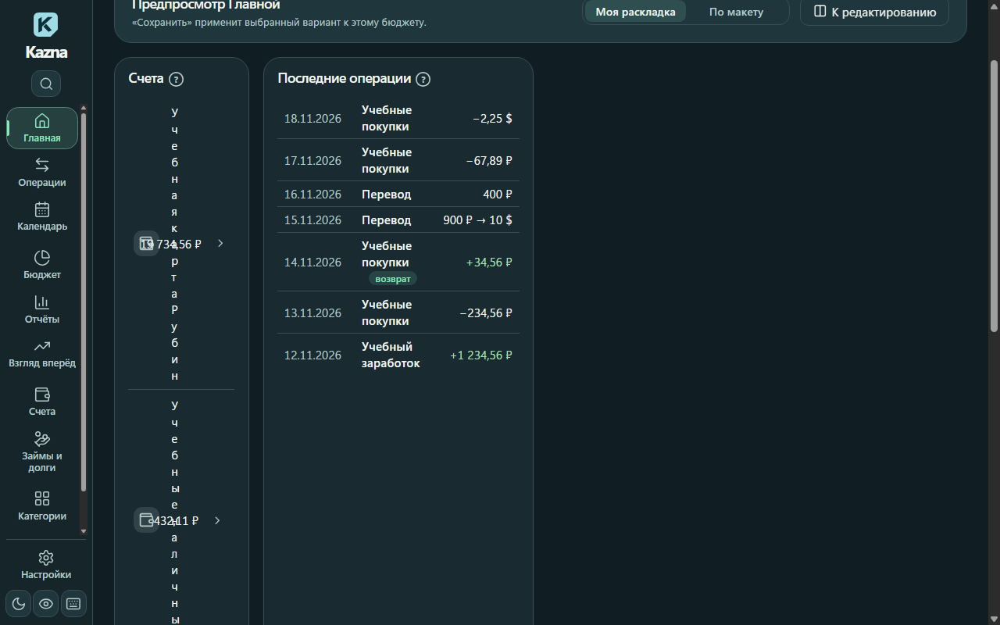
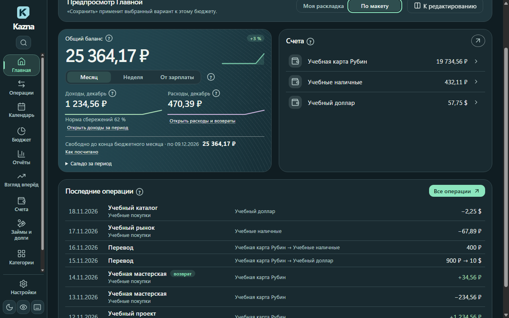
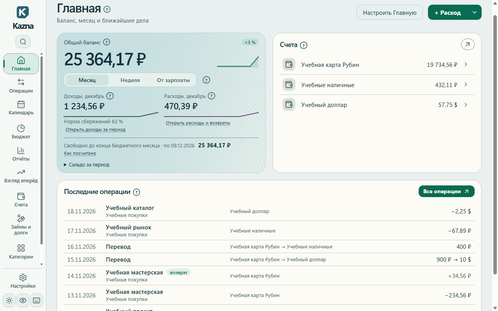
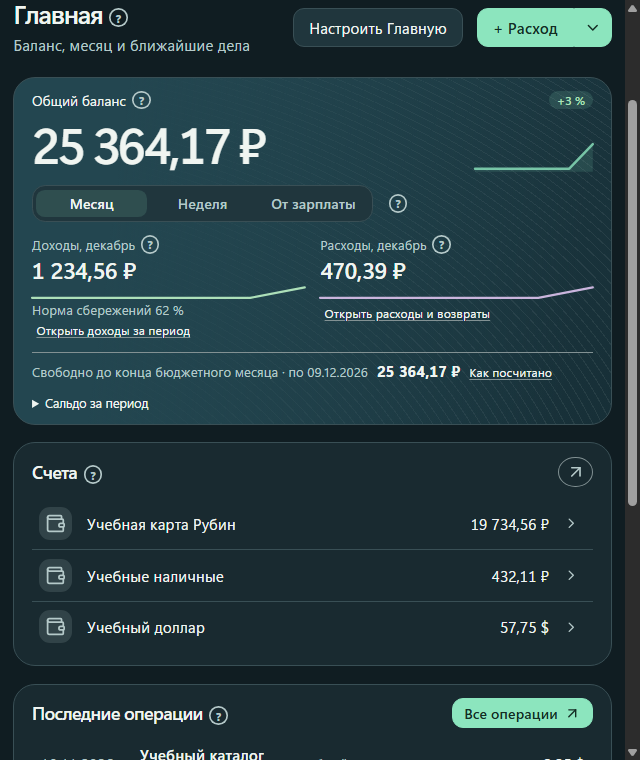

# Главная по макету и сравнение раскладок в Windows 11

В верхнем ряду баланса и счетов видны деньги текущего бюджета. Доходы и расходы находятся внутри баланса. Под ними открывается журнал последних операций. В работающем приложении один и тот же вымышленный бюджет открыли сначала в 0.44.0, затем в переносной 0.45.0. Исходную раскладку сравнили с макетом и сохранили выбор через «Настроить Главную → Сравнить раскладки». [PR №140 с результатами проверок](https://github.com/Xoma1818/p-treasury/pull/140).

| Главная 0.44.0 | После выбора макета в 0.45.0 |
|---|---|
|  |  |

| «Моя раскладка» | «По макету» |
|---|---|
|  |  |

| Светлая тема | Узкое окно |
|---|---|
|  |  |

## Что проверили в работающем приложении

Оператор работал в одном окне Windows 11 с отдельной базой, профилем WebView2 и папкой копий. Снимки 0.45.0 сделаны на [первой сборке кандидата](https://github.com/Xoma1818/p-treasury/actions/runs/46113244034/artifacts/15250523141), коммит db657615. SHA-256 программы — `2574deaf6134b7dfd1e2d0ffad343ee2fb5a3758d947f913e5d94a0d3438a6cd`.

| Действие | Результат |
|---|---|
| Переключить личную раскладку и макет, затем отменить | На экране меняется расположение карточек. Запись прежней раскладки v2 в SQLite осталась прежней. Явная прежняя v3 и бюджет с пустой настройкой также сохранили свой вид. |
| Сохранить при занятой SQLite и повторить после снятия блокировки | Kazna показала ошибку и сохранила черновик в редакторе. После повтора и закрытия приложения новый процесс открыл выбранную раскладку. |
| Сверить деньги после перезапуска | Все 7 операций совпали. Остатки составили 19 734,56 ₽, 432,11 ₽ и 57,75 USD. При учебном курсе 90 ₽ за доллар общий баланс составил 25 364,17 ₽. За бюджетный месяц с 10 ноября по 9 декабря показаны доход 1 234,56 ₽ и расход 470,39 ₽ с учётом возврата. |
| Открыть данные с карточек | Из доходов открылась одна операция за период, из расходов — четыре, включая возврат. Со счёта наличных открылись две операции. «Все счета» открыл раздел счетов, «Все операции» — журнал из семи строк. Проверены пояснения к суммам, выбор периода и маскирование денег. |
| Изменить сохранённый макет | После изменения ширины, скрытия и показа карточек личный черновик сохранился при сравнении. Второй бюджет получил свою раскладку. В редактор вошли как с Главной, так и из настроек. |
| Открыть новый бюджет | Мастер дал макет пустому бюджету с одним счётом. В отдельном демонстрационном бюджете тот же макет показал реальные учебные операции. |
| Изменить ширину окна | При 1280 px баланс и счета имеют общую верхнюю границу, журнал занимает следующую строку. При 640 px все три карточки расположились вертикально, горизонтальной прокрутки страницы нет. |

## Клавиатура

На первом кандидате выявили ошибку при открытии строки журнала клавишей Enter. Форма получала фокус, и продолжение того же нажатия отправляло её на сохранение. Причину подтвердили по событиям WebView2 и повтором на том же EXE с подавлением стандартного действия Enter на строке.

Обработчик строки теперь отменяет это действие до открытия формы. На исправленном EXE клавиша Tab перевела фокус с «Все операции» в первую строку, Enter открыл расход 2,25 USD от 18 ноября со счёта «Учебный доллар». Форма осталась открытой, отправок было **0**. Escape вернул фокус в ту же строку. Совпали все поля семи операций, строки истории изменений и состояние отмены и повтора.

На Windows 11 Pro 26H2 x64, сборка 26300.10075, повторили матрицу на трёх отдельных профилях. Сверили прежний бюджет, новый пустой с одним счётом и демонстрационный с 95 операциями. Отдельно повторили расшифровку баланса 12 345 JPY на двух чистых бюджетах, в том числе 30 раз с замедлением WebView2. Во всех 50 случаях показались строка счёта и правильный итог. В сценарии покупки на 1 000 JPY прогноз составил 11 345 JPY.

SHA-256 исправленного EXE — `708d99daf30a847b39f9aa26b56f620f38d539708203a95e13d4b107ce510f9c`. Все пять снимков 0.45.0 совпали побайтно при повторной проверке. [Проверенная переносная сборка e8c8a9d2](https://github.com/Xoma1818/p-treasury/actions/runs/46115183698/artifacts/15252086604) · [Итоговые проверки PR](https://github.com/Xoma1818/p-treasury/pull/140/checks).
