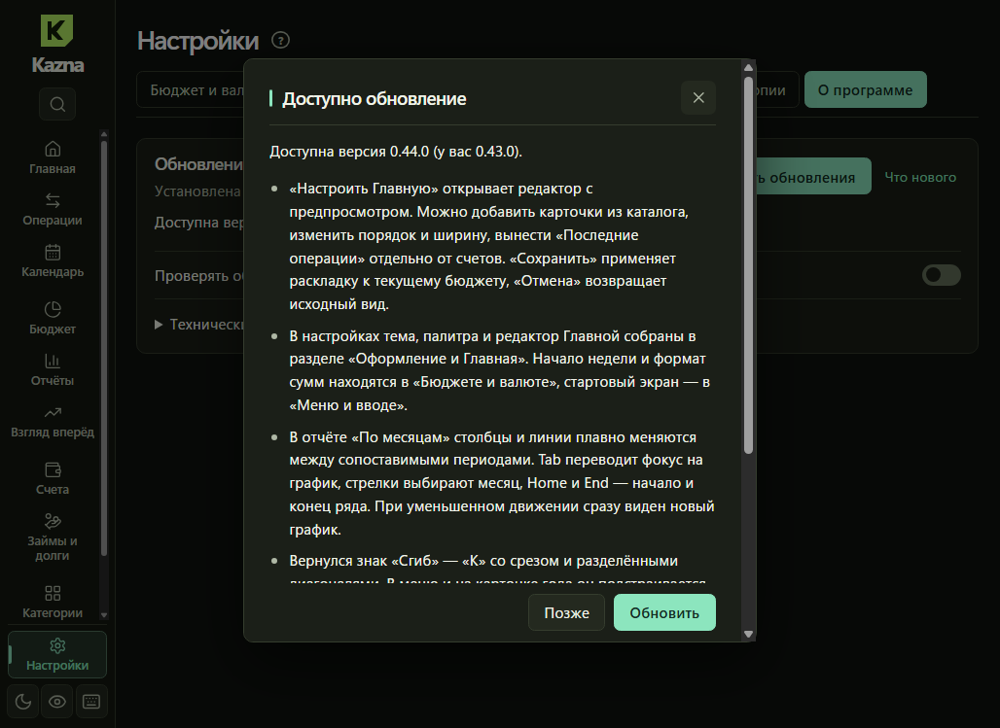
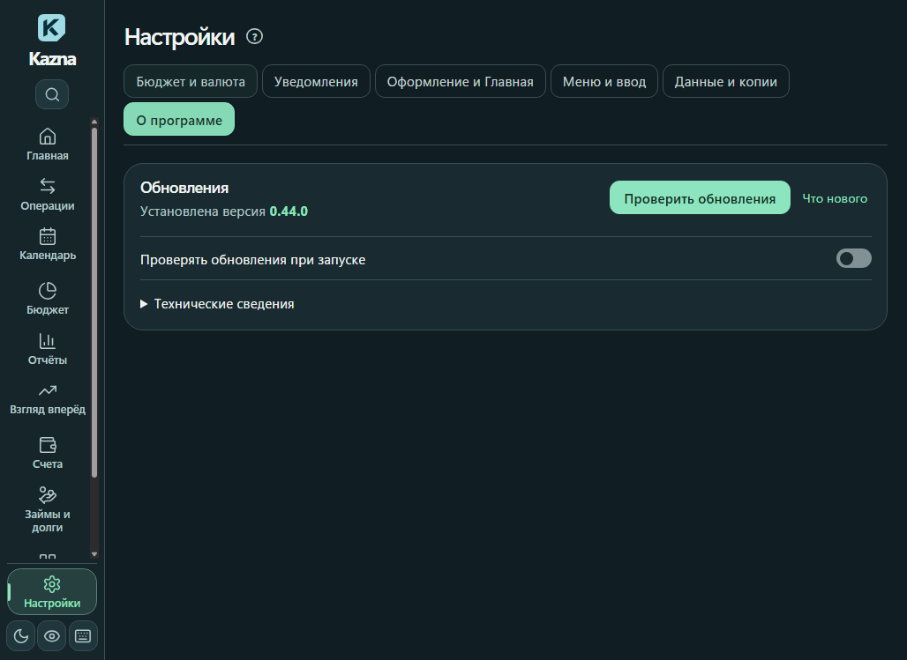
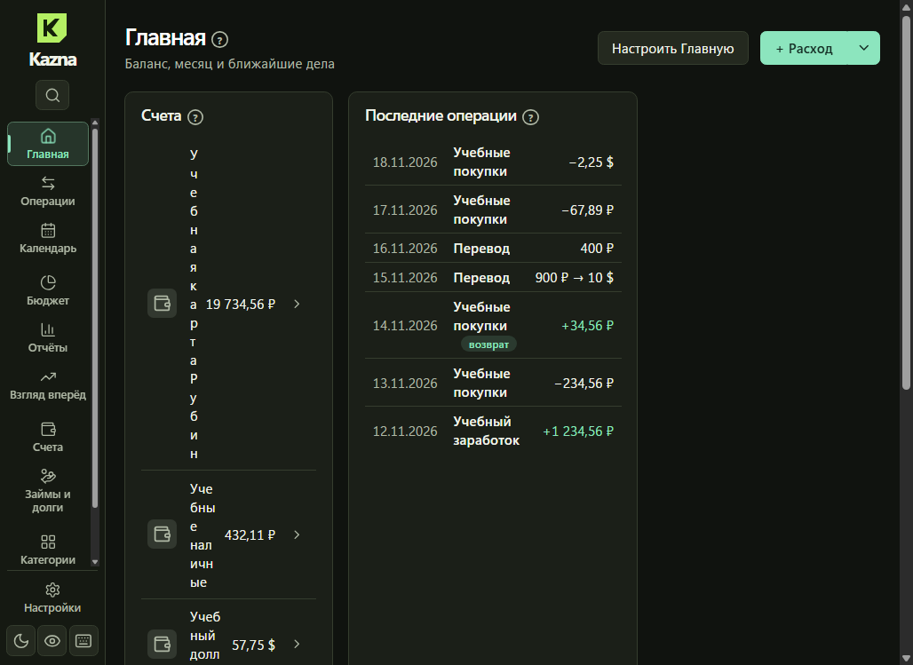
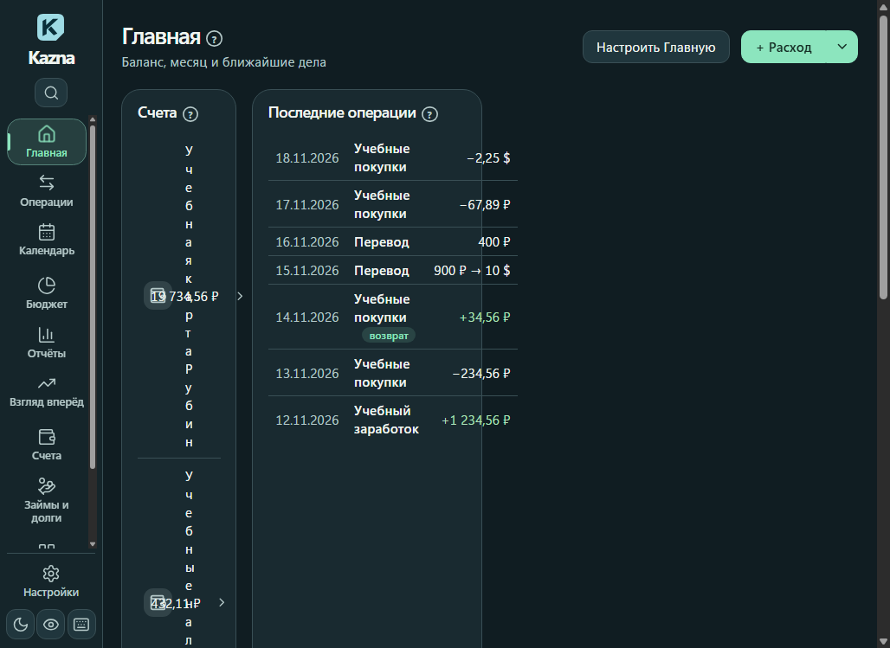
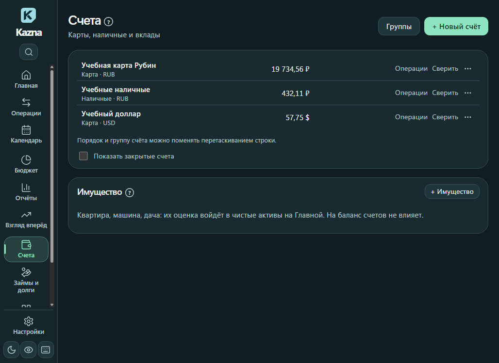
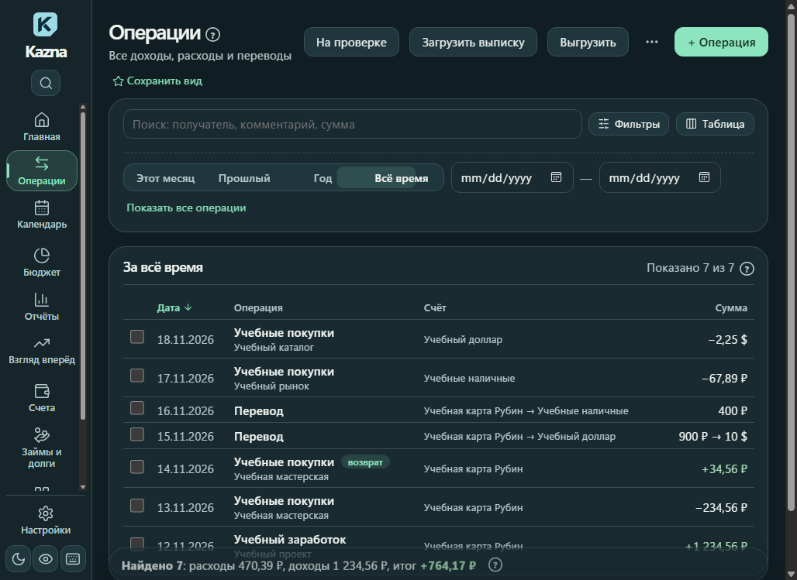

# Обновление Kazna с 0.43.0 до 0.44.0 через настройки

**Проверка прошла 28 ноября 2026 года с первой попытки.** На чистой Windows 11 Enterprise ARM64 (сборка 26200) установили официальную x64-версию 0.43.0. В «Настройки → О программе» нажали «Проверить обновления», затем «Обновить». Kazna создала резервную копию и самостоятельно открыла версию 0.44.0. Сохранились все семь операций, остатки трёх счетов, 48 настроек и раскладка Главной. [Прогон Windows 11](https://github.com/Xoma1818/p-treasury/actions/runs/46111463950/job/140875714017) · [Архив со снимками, журналом процессов и четырьмя копиями учебной базы](https://github.com/Xoma1818/p-treasury/actions/runs/46111463950/artifacts/15249164329).

## Сверка бюджета

| Показатель | До обновления · 0.43.0 | После обновления · 0.44.0 |
|---|---:|---:|
| Операции за всё время | 7 | 7 |
| Учебная карта Рубин | 19 734,56 ₽ | 19 734,56 ₽ |
| Учебные наличные | 432,11 ₽ | 432,11 ₽ |
| Учебный доллар | 57,75 USD | 57,75 USD |
| Общий остаток на 18 ноября при курсе 90 ₽ за доллар | 25 364,17 ₽ | 25 364,17 ₽ |
| Доход за 10 ноября — 9 декабря | 1 234,56 ₽ | 1 234,56 ₽ |
| Расход за тот же период с учётом возврата | 470,39 ₽ | 470,39 ₽ |
| Сохранённые настройки бюджета | 48 | 48 |

Сверили каждое поле семи операций и каждое значение настроек. Проверили остатки в строках экрана «Счета», в данных работающего приложения и независимо по операциям SQLite. На Главной первой осталась половинная карточка «Счета и последние операции», за ней — полноширинная «Баланс и месяц». Сохранились скрытые карточки, тёмная тема, мятный акцент, компактная плотность, масштаб 110 % и открытие операций в диалоге. Для старого бюджета появилась палитра по умолчанию «Петроль и фарфор».

| Предложение обновления в 0.43.0 | Установленная версия 0.44.0 |
|---|---|
|  |  |

| Главная до обновления | Та же раскладка после обновления |
|---|---|
|  |  |

| Остатки после перезапуска | Журнал за всё время |
|---|---|
|  |  |

## Перезапуск и резервная копия

Использовали отдельный вымышленный бюджет, профиль WebView2 и папку копий. На машине одновременно работало одно главное окно. В 08:22:30 МСК процесс 0.43.0 (PID 2936) запустил скачанный приложением установщик (PID 8292). В 08:22:32 установщик запустил 0.44.0 (PID 8404). У нового процесса обнаружили главное окно «Kazna». Путь программы сохранился, реестр показал версию 0.44.0, SHA-256 запущенного EXE совпал с файлом внутри официального установщика.

Пока автоматически открывшееся окно работало, сняли копию базы. Затем его штатно закрыли и заново открыли установленную 0.44.0 для чтения экранов и снимков. Сопоставили четыре состояния базы — до обновления, в автоматически открывшемся окне, после повторного открытия и в резервной копии самой Kazna перед установкой. Совпали версия схемы 32, столбцы и все строки 53 прикладных таблиц. Проверки целостности SQLite и внешних ключей прошли для каждой копии. [Сценарий оконной проверки и сверки](https://github.com/Xoma1818/p-treasury/tree/c71fbbde6a59cccd0454ae1c5e80bfa2775d734d/qa/inapp-0430-0440).

| Файл | SHA-256 |
|---|---|
| Установщик, скачанный самой Kazna | `280c0247455758baecf278d29e626fd13e03c6b827b52a8e691b4cec0bb2df3b` |
| Перезапущенный `Kazna.exe` 0.44.0 | `7a31eeac26e310535dcdeb4b9484d82105e6617ba2fa2435b0590f24880998ff` |

## Публичный выпуск

28 ноября 2026 года в 08:15 МСК опубликованы установщик, его подпись, переносной архив и манифест обновления. Тег `v0.44.0` указывает на коммит слияния №136. Дерево файлов совпало с проверенным кандидатом. [Релиз 0.44.0](https://github.com/Xoma1818/p-treasury-releases/releases/tag/v0.44.0) · [Сборка и публикация](https://github.com/Xoma1818/p-treasury/actions/runs/46109416005) · [Коммит fd280e55](https://github.com/Xoma1818/p-treasury/commit/fd280e55e9074f2eeb950a6e53359a628cc4ed2a).

Все четыре файла скачали без авторизации и сверили их размеры и SHA-256 с данными GitHub. Подпись установщика проверили открытым ключом из Kazna 0.43.0. Постоянный манифест обновлений побайтно совпал с манифестом выпуска. Обе записи Windows x64 вели к этому установщику и содержали его подпись. В переносном архиве подтверждены x64-файл `Kazna.exe` версии 0.44.0 и маркер `portable`. [Манифест выпуска](https://github.com/Xoma1818/p-treasury-releases/releases/download/v0.44.0/latest.json).
