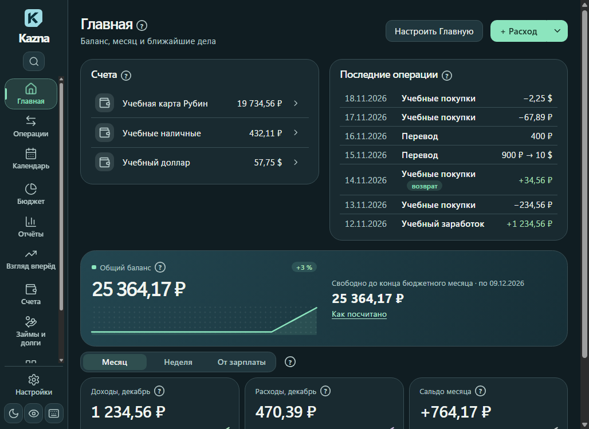
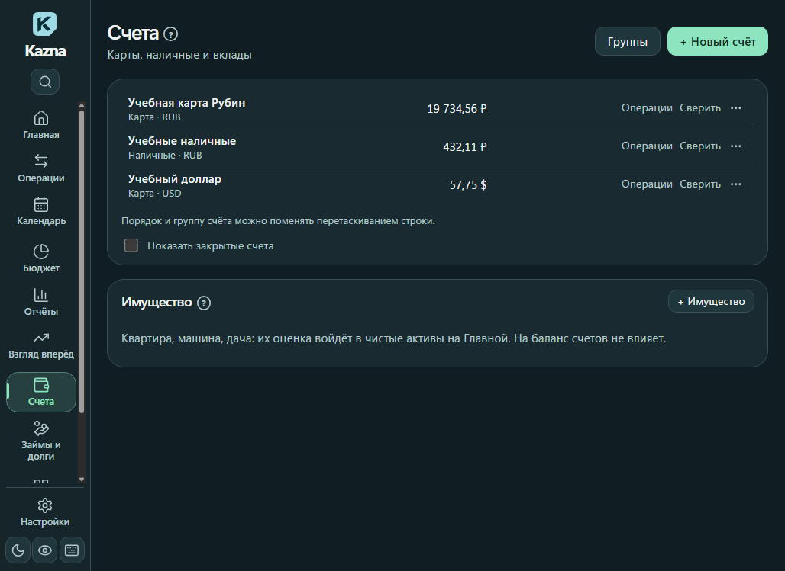
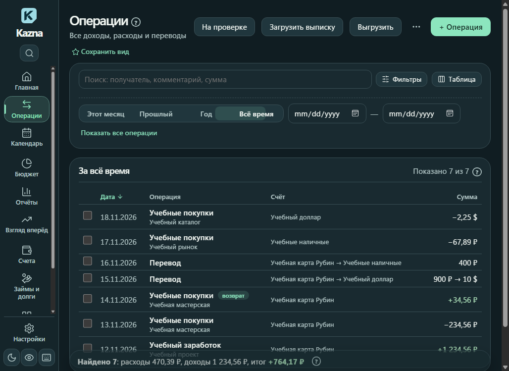
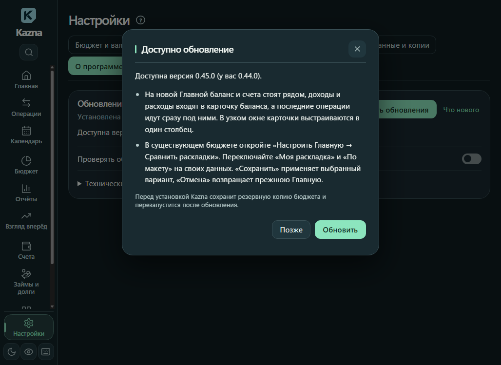
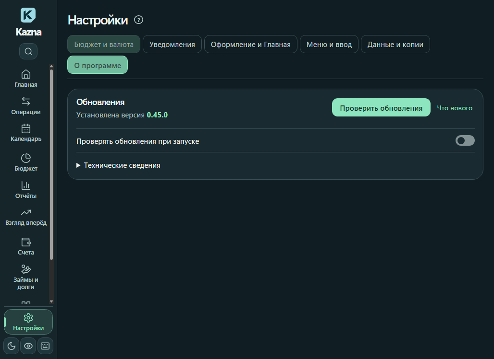

# Обновление Kazna с 0.44.0 до 0.45.0 через настройки

28 ноября 2026 года официальная x64-версия Kazna 0.44.0 обновилась с первой попытки на чистой Windows 11 Enterprise ARM64, сборка 26200. В одном окне открыли «Настройки → О программе», нажали «Проверить обновления» и «Обновить». Kazna создала резервную копию и автоматически открыла 0.45.0. Сохранились все семь операций, остатки трёх счетов и личная раскладка Главной. [Журнал оконной проверки](https://github.com/Xoma1818/p-treasury/actions/runs/46129962737/job/140932742115) · [Архив со снимками, журналом процессов и четырьмя снимками учебной базы](https://github.com/Xoma1818/p-treasury/actions/runs/46129962737/artifacts/15257253843).

## Личная раскладка Главной

В редакторе 0.44.0 изменили ширину «Последних операций» и нажали «Сохранить». В первом ряду оказались «Счета» слева и «Последние операции» справа, каждая карточка на половину ширины. Во втором ряду баланс занимал всю ширину. Остальные 16 карточек были скрыты.

После обновления сравнили сохранённое значение `home_layout` версии 3 и сами карточки на экране. Состав, порядок, координаты и ширина трёх видимых карточек совпали при ширине области просмотра 935 CSS-пикселей и масштабе 110 %. Все 16 скрытых карточек остались скрытыми. Новый макет доступен через «Настроить Главную → Сравнить раскладки». [Как выглядит новый макет и его предпросмотр](home-overview-0.45.0.md).

| Главная в 0.44.0 | Та же личная раскладка в 0.45.0 |
|---|---|
|  |  |

## Операции и остатки

| Показатель | До обновления | После обновления |
|---|---:|---:|
| Операции за всё время | 7 | 7 |
| Учебная карта Рубин | 19 734,56 ₽ | 19 734,56 ₽ |
| Учебные наличные | 432,11 ₽ | 432,11 ₽ |
| Учебный доллар | 57,75 USD | 57,75 USD |
| Общий баланс при учебном курсе 90 ₽ за доллар | 25 364,17 ₽ | 25 364,17 ₽ |
| Доход за 10 ноября — 9 декабря | 1 234,56 ₽ | 1 234,56 ₽ |
| Расход за тот же период с учётом возврата | 470,39 ₽ | 470,39 ₽ |
| Сохранённые настройки бюджета | 48 | 48 |

Сравнили каждое поле семи операций, строки экрана «Счета» и независимый расчёт остатков по начальным суммам и проводкам SQLite. Все значения 48 настроек совпали.

| Счета после обновления | Журнал после обновления |
|---|---|
|  |  |

## Перезапуск и резервная копия

В 12:24:14 МСК процесс 0.44.0 (PID 5260) запустил скачанный приложением установщик (PID 6892). В 12:24:16 установщик запустил процесс 0.45.0 (PID 2612). У нового процесса было видимое окно «Kazna». Реестр и версия установленной программы показали 0.45.0.

Пока автоматически открывшееся окно работало, сняли копию его базы. Затем окно закрыли и повторно открыли установленную версию для чтения экранов и снимков. Сопоставили четыре состояния базы — перед нажатием «Обновить», в автоматически открывшемся процессе, при повторном открытии и в резервной копии самой Kazna. Везде совпали схема 32, столбцы и все строки 53 прикладных таблиц. Проверки целостности SQLite и внешних ключей прошли на каждой копии. [Сценарий и данные для воспроизведения](https://github.com/Xoma1818/p-treasury/tree/c0ae374230803075940256924c2c604c06865f86/qa/inapp-0440-0450).

| Предложение обновления в 0.44.0 | Настройки после обновления |
|---|---|
|  |  |

## Публичный выпуск

Релиз опубликован 28 ноября в 12:18 МСК. Тег `v0.45.0` указывает на коммит слияния [PR №140](https://github.com/Xoma1818/p-treasury/pull/140). Дерево файлов совпадает с проверенным кандидатом `a1d6fb38`. [Релиз Kazna 0.45.0](https://github.com/Xoma1818/p-treasury-releases/releases/tag/v0.45.0) · [Сборка и публикация](https://github.com/Xoma1818/p-treasury/actions/runs/46128385589) · [Коммит слияния](https://github.com/Xoma1818/p-treasury/commit/c3db9597faa46d58546c39224984793cc6b1e2c1).

Скачали все четыре файла выпуска без авторизации. Их размеры и SHA-256 совпали с опубликованными GitHub. Подпись установщика проверили открытым ключом из 0.44.0. Постоянный манифест побайтно совпал с манифестом релиза. Обе записи Windows x64 указывали на установщик 0.45.0 и содержали его подпись. В переносном архиве проверили версию EXE, архитектуру x64 и маркер `portable`. [Манифест релиза](https://github.com/Xoma1818/p-treasury-releases/releases/download/v0.45.0/latest.json).

| Файл в оконной проверке | SHA-256 |
|---|---|
| Установщик, скачанный самой Kazna (8 362 093 байта) | `afb8fc4f105851fcf971e7eaf47b4894efce08cd90ba234045b52b13466e0239` |
| Установленный и автоматически запущенный Kazna.exe | `e29a8deb9efe2c757e075d67fe921eedfab6fe837b69f4509670e9eaca8e0d34` |
