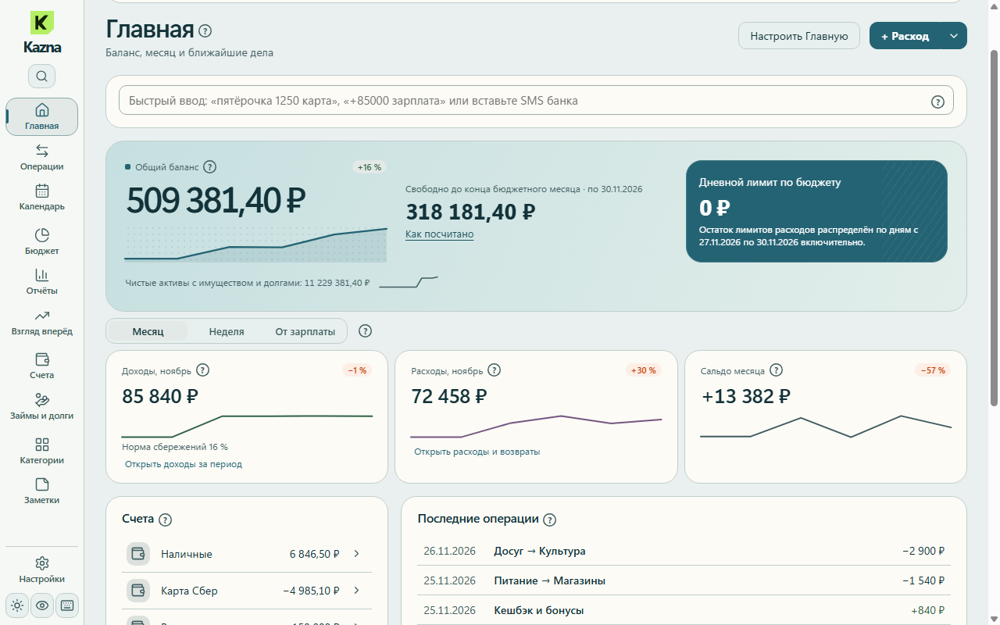
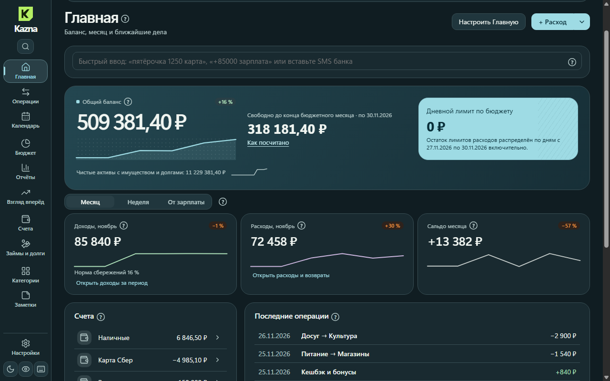
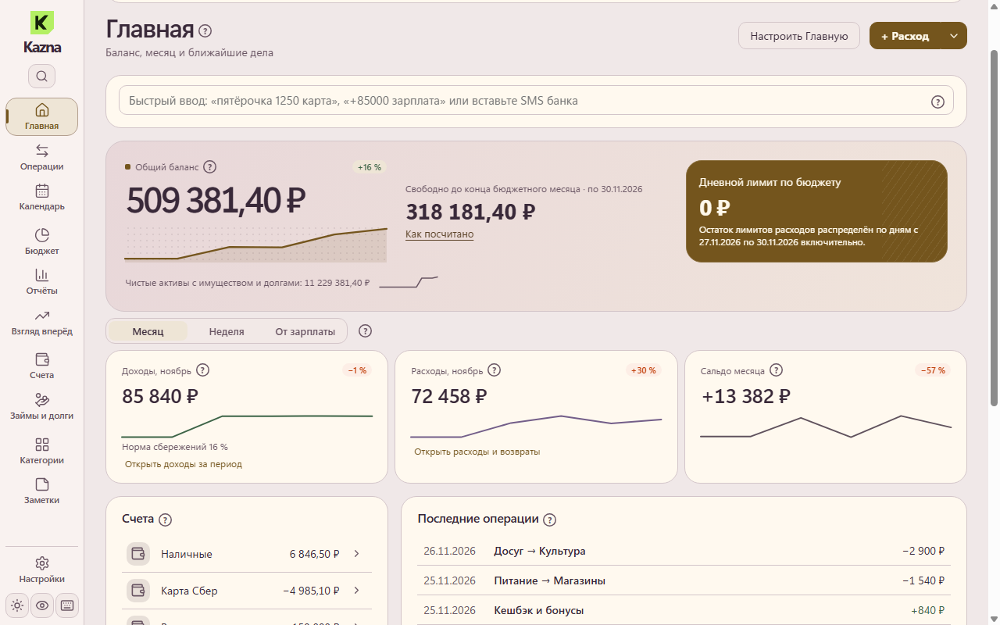
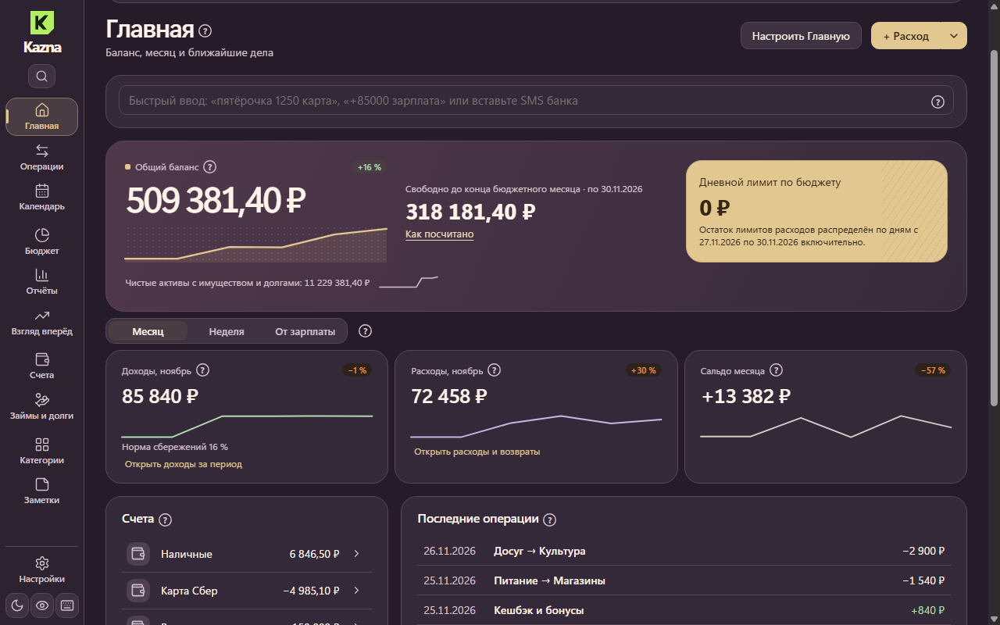
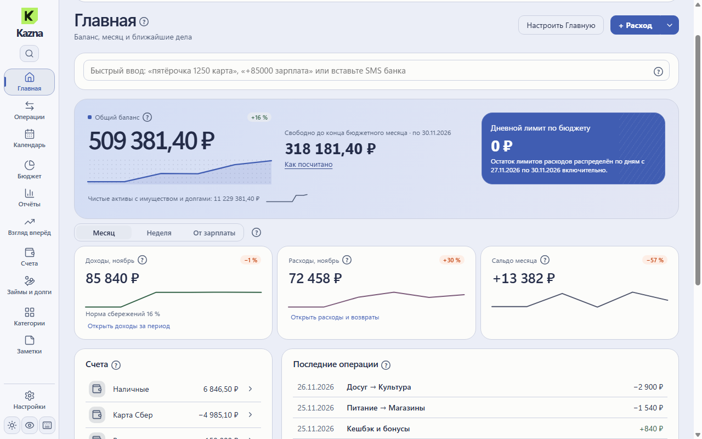
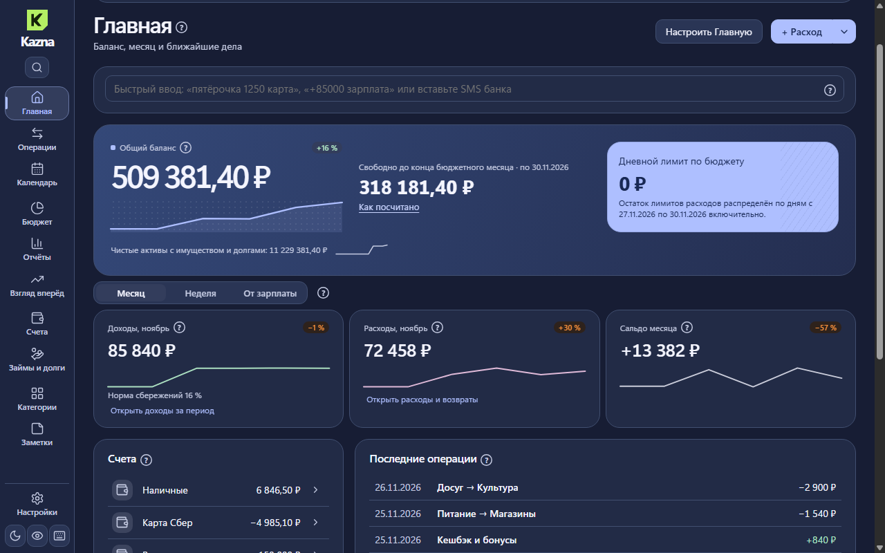
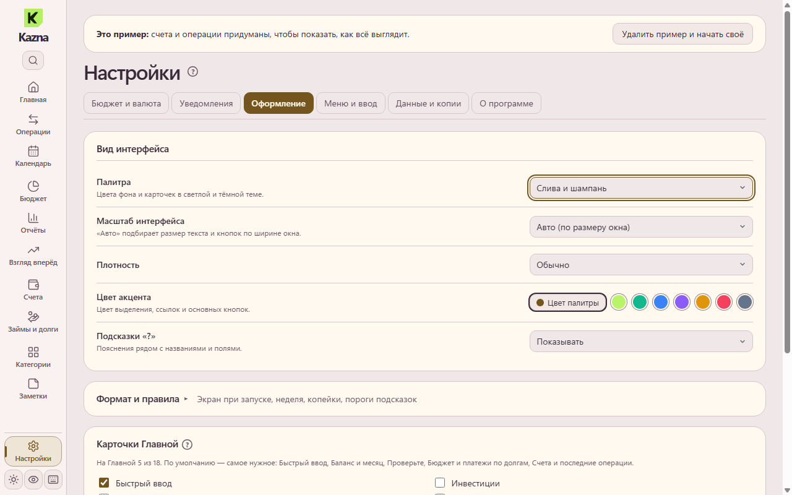

# Три палитры «Пульса» в Windows 11

27 ноября 2026 года. Проверена переносная сборка Kazna 0.44.0 из [коммита 98235746](https://github.com/Xoma1818/p-treasury/commit/98235746ffcf10b6051d72cb974453063572ab6c). [Сборка в Actions](https://github.com/Xoma1818/p-treasury/actions/runs/45914830494) · [Проверенный архив](https://github.com/Xoma1818/p-treasury/actions/runs/45914830494/artifacts/15162163653).

EdgeDriver управлял одним окном Kazna на отдельном рабочем столе Windows 11. Размер области приложения 1280 × 800, масштаб 100%. Использовались вымышленный бюджет, отдельный профиль WebView2 и отдельная папка копий. На Главной общий баланс составлял 509 381,40 ₽. Для сопоставимых снимков штатной настройкой сняли галочку у карточки «Проверьте».

| Палитра | Светлая тема | Тёмная тема |
|---|---|---|
| Петроль и фарфор |  |  |
| Слива и шампань |  |  |
| Кобальт и мел |  |  |

## Результаты

- Все шесть сочетаний выбраны через интерфейс. В каждом менялись фон плитки доходов и цвет линии и заливки графика общего баланса. На одних операциях геометрия графика совпала во всех вариантах.
- С личным мятным акцентом сменили палитру, закрыли Kazna и запустили заново. Сохранились «Слива и шампань», тёмная тема, мятный акцент и компактная плотность. В учебной базе по-прежнему 6 счетов и 94 операции.
- В профиле 0.43.0 заранее выбрали светлую тему, мятный акцент и компактную плотность. При первом открытии его копии в 0.44.0 появилась «Петроль и фарфор», прежние настройки и количество счетов и операций сохранились. Открытие копии той же базы в пустом профиле WebView2 восстановило эти настройки из SQLite. Переключение на «Кобальт и мел» сохранило мятный акцент.
- Кнопкой «Цвет палитры» вернули фирменный акцент. При выборе «Как в системе» Kazna применила текущую тёмную тему Windows.
- На этом коммите прошли 218 тестов интерфейса. При независимом ревью проверили читаемость на обоих концах градиента баланса во всех палитрах с фирменным и семью личными акцентами. Минимальное отношение контраста для ссылки «Как посчитано» составило 4,74:1, для предупреждения об отсутствующем курсе — 5,23:1. [Проверки исходников](https://github.com/Xoma1818/p-treasury/actions/runs/45914830532).

SHA-256 проверенного Kazna.exe — `3e9e147ce1aaaf1869d83db37dc44eb64f906fc1219a50facb6a896ae8423e94`.
