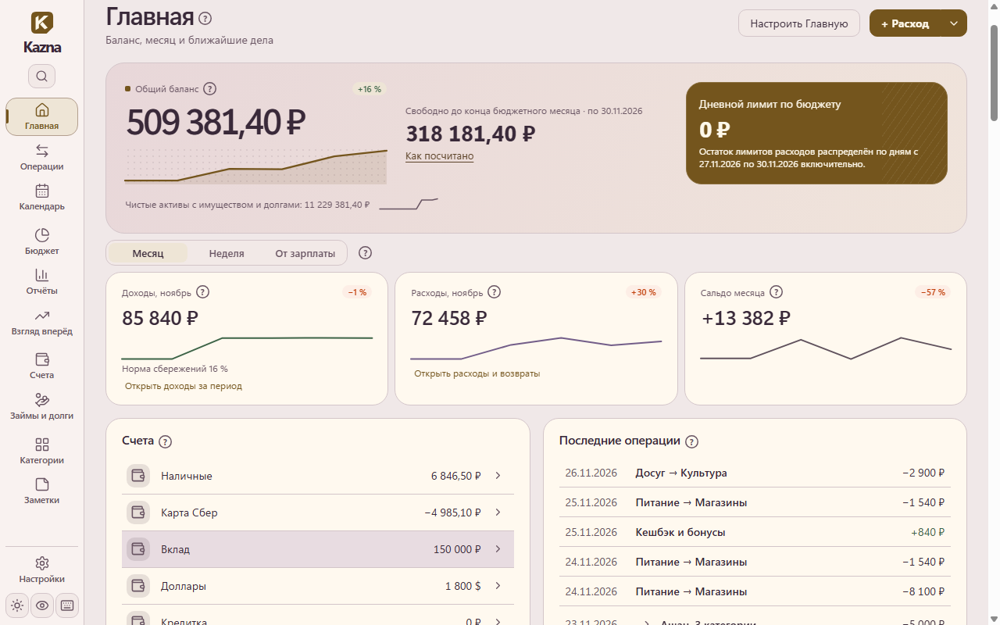
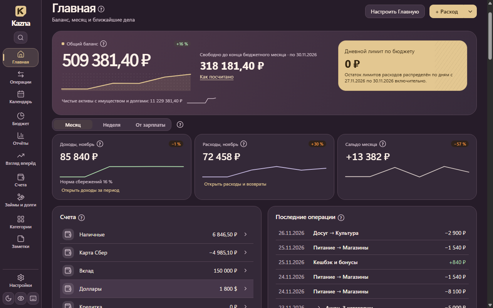
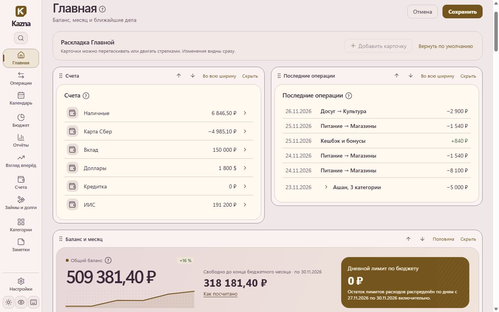
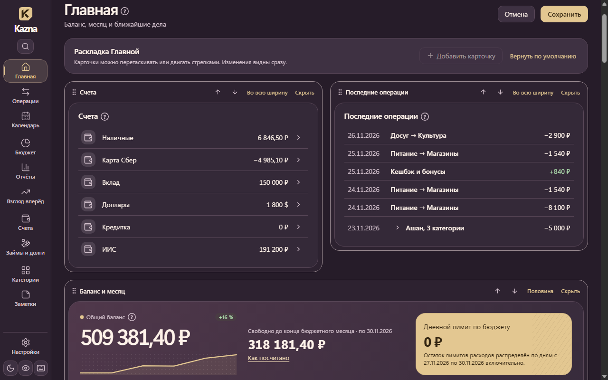
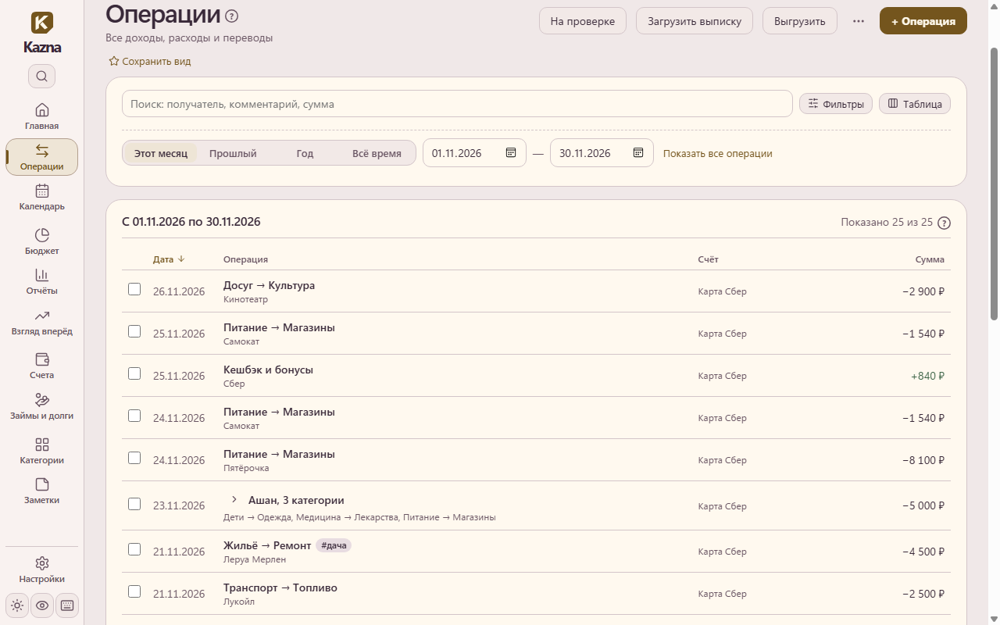
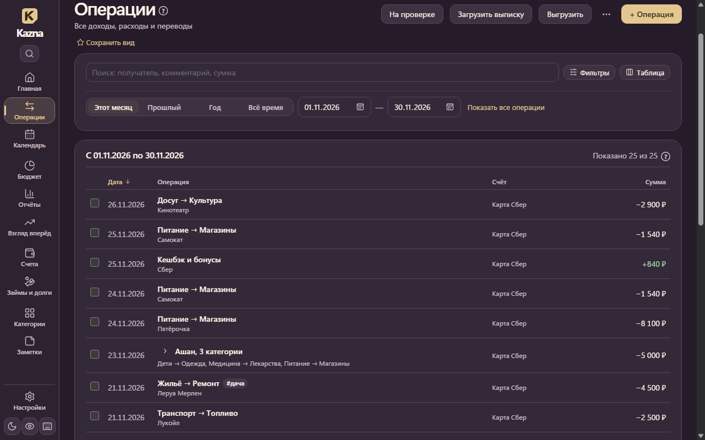
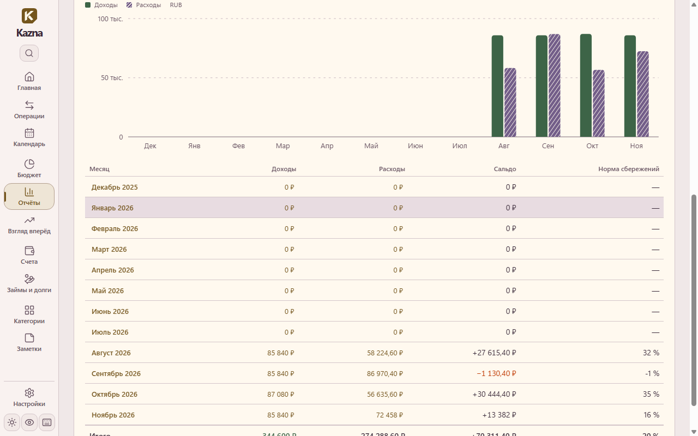
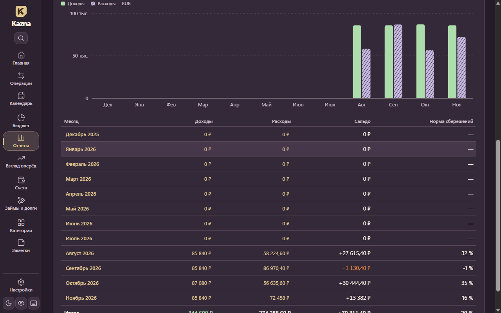
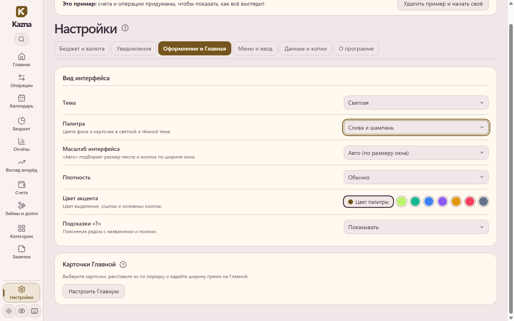
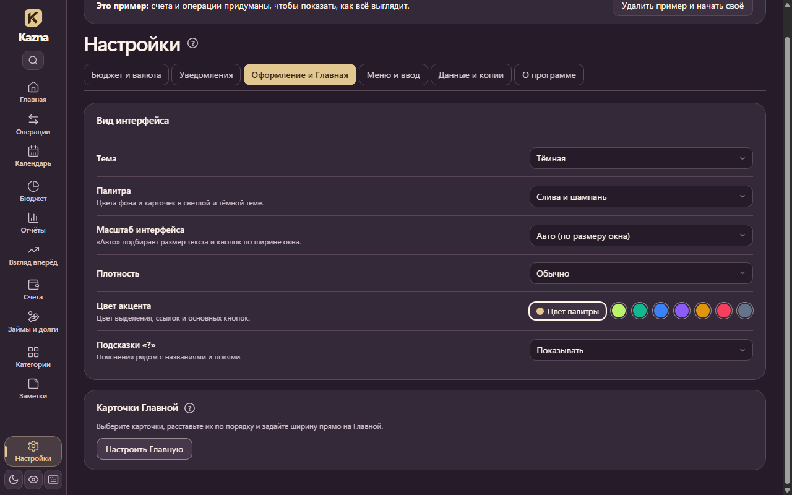

# Kazna 0.44.0 — Главная, настройки и графики в Windows 11

27 ноября 2026 года. Основную матрицу прошла переносная x64-сборка из [коммита 34501057](https://github.com/Xoma1818/p-treasury/commit/34501057a7c17f4b934bb3f155f36ae0de6e0819). SHA-256 загруженного архива совпал с данными Actions. SHA-256 исполняемого файла — `7b06f6f668c73c5710fc2f6fafc1f736585c3aada1d77e9c03a9be0293499862`. [Сборка Windows](https://github.com/Xoma1818/p-treasury/actions/runs/45926074920) · [PR №136](https://github.com/Xoma1818/p-treasury/pull/136).

Исправление фокуса, восстановление старого бюджета в пустом профиле, доступность и сохранение годового PNG проверены на [коммите 2ef18b5b](https://github.com/Xoma1818/p-treasury/commit/2ef18b5b2fbe5b061eabac5d9ae6acf7d6042d9b). SHA-256 архива — `47549de0c1f67319563af6a49c257df16b75cb85cc77e31432b7a7670cee28f6`, исполняемого файла — `566451d063aa162db76c5d89be0f35ad65d205657d3dbbc9cbe0ab40c55596fe`. [Артефакт переносной сборки](https://github.com/Xoma1818/p-treasury/actions/runs/46000646799/artifacts/15200370268).

### Что проверено в окне

EdgeDriver управлял установленным WebView2 внутри Kazna на отдельном рабочем столе Windows 11, сборка ОС 26300. Основной размер окна — 1280 × 800. У каждого прогона своя папка базы, профиля и резервных копий. Для проверки быстрого ввода основное окно скрывали. Демобюджет создавали кнопкой «Посмотреть на примере».

| Действие | Ожидание и фактический результат |
|---|---|
| Открыть настройки через Ctrl+K | «Начало недели» раскрыло нужную группу во вкладке «Бюджет и валюта» и передало фокус полю дня. «Настроить Главную» открыло тот же редактор, что и кнопка в оформлении, с фокусом на «Отмена». |
| Отменить несколько правок | Открыли каталог, закрыли по Escape и проверили возврат фокуса. Добавили карточку, разделили старую пару и скрыли быстрый ввод. До сохранения запись в базе совпадала с исходной строкой v2. «Отмена» вернула половинную группу, видимость и порядок. |
| Изменить порядок, ширину и сохранить | Передвинули «Счета» клавишей Enter на кнопке «Выше», перетащили «Быстрый ввод» мышью, добавили карточку. Записалась раскладка v3. После закрытия приложения и запуска нового процесса (PID 6840 → 3392) вернулись те же порядок, ширины и видимость. Полные записи операций и счетов совпали. |
| Изменить размер окна | В окне 640 × 760 половинная карточка заняла всю доступную ширину, 598 px. Каталог открылся и закрылся по Escape. После возврата к 1280 × 800 та же карточка заняла 544 из 1103 px. Горизонтальной прокрутки страницы в обоих случаях не было. |
| Добавить цифру из отчёта на Главную | «Проверочный расход» появился в карточке «Свои цифры». В сохранённой раскладке изменилось только её присутствие в списке скрытых. |
| Сменить бюджет с черновиком и восстановить резервную копию | В настройках создали и открыли второй учебный файл. В нём настроили Главную и вернулись в первый бюджет. В первом осталась его прежняя раскладка, несохранённое скрытие «Счетов» отброшено. Затем сбросили и сохранили другую раскладку. Восстановление копии вернуло сохранённую v3 и исходные финансовые записи. Для создания и восстановления копии передали путь штатным командам Tauri, минуя системный диалог файла. |
| Обойти меню в обеих темах | В каждой теме открылись все 11 доступных разделов от Главной до настроек. Совпали выбранный пункт и открытый экран. Край страницы уместился в окно, сообщение о сбое интерфейса не появилось. Открыли и закрыли объяснение баланса и форму нового расхода. |
| Открыть быстрый ввод | При скрытом основном окне отдельное окно показало поле ввода, светлую тему и палитру «Кобальт и мел». Скрытие проверено по дескриптору Win32. Для вызова использовали команду приложения `open_quick`. [Снимок окна](../design/screens/pulse-workspace-0440/quick-cobalt-light.png). |

### Сверка денег

При повторном запуске, возврате в первый бюджет и восстановлении копии сравнивали содержимое всех **94 операций** и всех **6 счетов**. Для ноября 2026 года каждый раз получены доходы **85 840,00 ₽**, расходы **72 458,00 ₽**, разница **13 382,00 ₽**. Общий остаток в базовой валюте **509 381,40 ₽**. Счета сверены каждый в своей валюте.

| Счёт | До правок и после сверки |
|---|---:|
| Наличные | 6 846,50 ₽ |
| Карта Сбер | −4 985,10 ₽ |
| Вклад | 150 000,00 ₽ |
| Доллары | 1 800,00 USD |
| Кредитка | 0,00 ₽ |
| ИИС | 184 000,00 ₽ |

У ИИС остаток по операциям составляет 184 000,00 ₽. Для инвестиционного счёта Главная показывает последнюю оценку активов — на снимках это 191 200,00 ₽.

### Бюджет, созданный в 0.43.0

В [опубликованной 0.43.0](https://github.com/Xoma1818/p-treasury-releases/releases/tag/v0.43.0) создали отдельный демобюджет и через интерфейс выбрали светлую тему, компактную плотность, фиолетовый акцент и половину ширины для старой группы «Счета и последние операции». SHA-256 запускавшегося EXE — `420f98092acd48f553e62066644049d047a9768feb052a1cdb8841ee94d7f1ef`.

После закрытия 0.43.0 скопировали SQLite вместе с журналом WAL и профилем WebView2. При открытии в 0.44.0 из коммита 34501057 в базе совпали **все 48 записей настроек**, все строки операций и счетов, отчёт за ноябрь и общий остаток. В интерфейсе сохранились светлая тема, компактная плотность, фиолетовый акцент и прежняя половинная группа. Отсутствовавшая в 0.43.0 палитра получила значение по умолчанию «Петроль и фарфор».

На **2ef18b5b** второй экземпляр этих данных открыли с пустым профилем WebView2. Те же четыре параметра оформления восстановились из SQLite. Все 48 настроек и финансовая сверка совпали. Через **Настройки → Данные и копии** сделали резервную копию. Затем выбрали кобальтовую палитру, розовый акцент и сохранили раскладку v3. Отмена в диалоге восстановления оставила v3. При повторе Kazna показала в копии 94 операции. Подтверждение вернуло прежнюю группу v2, «Петроль и фарфор», фиолетовый акцент, исходные 48 настроек и все деньги. В обоих файловых диалогах путь передан штатной тестовой подстановкой `__ptPick`. Предпросмотр, отмена и подтверждение выполнены кнопками Kazna.

В том же окне открыли **Отчёты → Итоги года**, включили «Без сумм» и выбрали «Сохранить PNG». Путь к файлу также подставлен через `__ptPick`. Прочитан фактически записанный PNG 1080 × 1350. На нём видны знак «Сгиб», доли и дни, две денежные суммы скрыты. [Годовая карточка из Kazna](../design/screens/pulse-workspace-0440/year-hidden.png).

### Фокус и доступность на 2ef18b5b

- В каталоге было 14 доступных карточек. После «Показать все» каталог закрылся, кнопка его открытия стала недоступна, а фокус перешёл на «Сохранить». Скрыли «Счета» и снова открыли каталог. После добавления единственной карточки фокус вновь перешёл на «Сохранить». До нажатия Enter в базе лежала исходная v2. Enter записал v3.
- При настройке «Как в системе» WebView2 получил тёмную, затем светлую системную тему через протокол DevTools. Каждая из трёх палитр применилась в обеих темах. Штатный выбор плотности отработал для «Компактно», «Просторно» и «Обычно». На 125% область окна составила 1024 CSS-пикселя, на 100% — 1280. В обоих случаях страница уместилась по ширине.
- При эмуляции `forced-colors: active` и уменьшенного движения системный фон каталога был чёрным, текст управления белым. Фокус находился в открытом диалоге, Escape вернул его на «Добавить карточку». В отчёте клавиша End открыла подсказку последней точки с подписями доходов и расходов. [Каталог при высокой контрастности](../design/screens/pulse-workspace-0440/forced-colors-catalog.png).

### Экраны в двух темах

Палитра «Слива и шампань». В каждой паре совпадают данные, период и состояние экрана. Главная и редактор сняты на 2ef18b5b, журнал, отчёт и настройки — на 34501057. В редакторе у «Счетов» и «Последних операций» общая верхняя граница и ширина по 544 px.

| Экран | Светлая | Тёмная |
|---|---|---|
| Главная |  |  |
| Редактор Главной |  |  |
| Операции |  |  |
| Отчёт по месяцам |  |  |
| Настройки |  |  |

### Движение и клавиатура

В окне Kazna записаны переход Главная → Отчёты и три быстрые смены периода между октябрём и ноябрём. В покадровых измерениях у элементов рядов было до девяти одновременно работающих анимаций, после перехода — ноль. Нулевая линия сохраняла координату Y = 196. Команда End переводила фокус на последнюю точку, Home — на первую. В подсказке «Без сумм» доходы, расходы и сальдо заменялись на «•••». При эмуляции системной настройки уменьшенного движения за 450 мс смены периода у рядов не появилось анимаций.

Запись собрана из 127 кадров WebView2. В GIF оставлены 22 кадра с сохранением интервалов между ними. [Посмотреть движение, 2,5 МиБ](../design/screens/pulse-workspace-0440/monthly-motion.gif).

### Отдельные проверки в Edge

Координатор проверил в Edge 158.0.4370.45 сборку интерфейса из [коммита 2ef18b5b](https://github.com/Xoma1818/p-treasury/commit/2ef18b5b2fbe5b061eabac5d9ae6acf7d6042d9b). Модуль годовой карточки сформировал 12 PNG по 1080 × 1350 px для трёх палитр, двух тем и двух акцентов — фирменного и розового. На каждом PNG с эталоном «Сгиба» совпали все 3303 непрозрачных пикселя знака. В режиме «Без сумм» обе денежные строки содержали «•••», имя проверочной покупки отсутствовало. Этот прогон охватывает генератор PNG до системного диалога сохранения.

В независимом браузерном сценарии имитировали отказ первой записи раскладки. Предпросмотр и черновик сохранились, повторная попытка записала одну раскладку v3. Отмена смены файла оставила черновик открытым, подтверждённая смена бюджета закрыла его. В том же сценарии проверили исключение выключенного модуля из каталога и возврат фокуса на «Сохранить», когда каталог опустел.

Оконные прогоны в этом отчёте использовали переносные сборки и программный ввод EdgeDriver. Путь для системного диалога выбора файлов подставляла тестовая оснастка. При проверке быстрого ввода использовалось уже открытое окно. Обновление через настройки с 0.43.0 на опубликованную 0.44.0 предусмотрено после выпуска. [План приёмки и выпуска](../design/pulse-coral-plan.md).

### Автоматические проверки кандидата

Проверки окна Windows, включая повторный запуск из трея, выполняются на [исходниках 2ef18b5b](https://github.com/Xoma1818/p-treasury/actions/runs/46000723941). В задании «Установщик для Windows» отдельный шаг ставит собранную Kazna на одноразовой машине, читает ярлыки меню «Пуск» и рабочего стола и сравнивает девять размеров значка программы, установщика и деинсталлятора с ICO «Сгиба». Шаги и результаты доступны в [проверках PR №136](https://github.com/Xoma1818/p-treasury/pull/136/checks).
